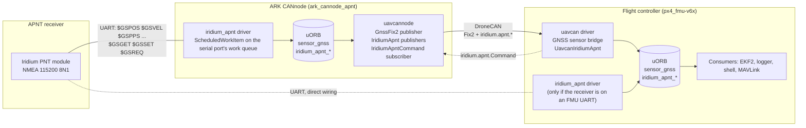
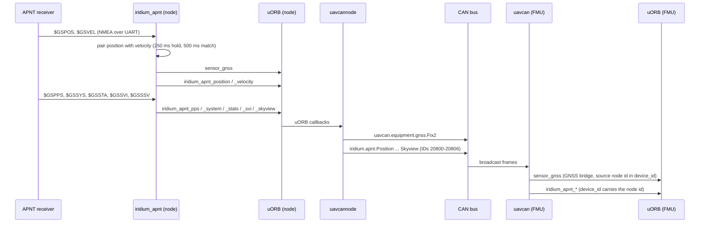
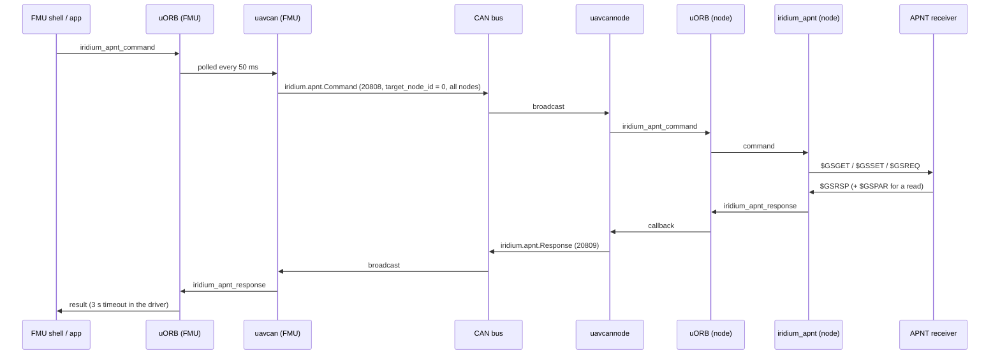

# Iridium APNT driver

PX4 driver for the RockBLOCK APNT (Iridium PNT) receiver. It reads the receiver's NMEA output from a serial port, publishes position and velocity as `sensor_gnss`, and publishes everything else the receiver reports as `iridium_apnt_*` uORB topics. It can run on the flight controller (FMU) or on an ARK CANnode, which relays the data to the FMU over DroneCAN.

This is a port of the Python driver in `~/mach/iridium`. It has not been tested on real hardware.

## Contents

- [Architecture](#architecture)
- [Driver](#driver)
- [uORB messages](#uorb-messages)
- [CAN node and DroneCAN](#can-node-and-dronecan)
- [Flight controller receiver](#flight-controller-receiver)
- [Build targets and configuration](#build-targets-and-configuration)
- [Limitations](#limitations)

## Architecture

Two deployments are supported. The receiver is wired either straight to the FMU (left, no CAN) or to an ARK CANnode (right).



### Data flow, receiver to FMU



### Command flow, FMU to receiver



## Driver

Source: `src/drivers/iridium_apnt/`.

| File | Purpose |
| --- | --- |
| `IridiumApnt.cpp/.hpp` | Module: serial I/O, command handling, uORB publishing |
| `apnt_nmea.cpp/.h` | NMEA parsing and building, no PX4 dependencies |
| `apnt_nmea_test.cpp` | gtest unit tests for the parser (15 tests) |
| `module.yaml` | Parameters and the `IAPNT_CFG` serial port setting |
| `Kconfig` | `CONFIG_DRIVERS_IRIDIUM_APNT` |

How it runs:

- `ModuleBase` + `ModuleParams` + `ScheduledWorkItem` on the work queue for the configured serial port (`px4::serial_port_to_wq`).
- Fixed 115200 baud through `device::Serial`. Reads are non-blocking and polled every 10 ms. `EAGAIN`, `EWOULDBLOCK` and `EINTR` are not errors.
- If the port can't be opened or drops, it retries every 2 s.
- Position is held for up to 250 ms to pair it with the matching velocity (matched by `gps_time` within 500 ms), then published together as one `sensor_gnss` sample.

### How `sensor_gnss` is filled

`sensor_gnss` is published as a multi-instance topic. Upstream PX4 renamed `sensor_gps` to `sensor_gnss`, so this is the "GPS alias".

| Field | Value |
| --- | --- |
| `latitude`, `longitude` | From `$GSPOS` |
| `altitude_ellipsoid` | WGS84 ellipsoid height |
| `altitude_msl` | Ellipsoid height minus `IAPNT_GEOID_M` |
| `vel_north`, `vel_east`, `vel_down` | From `$GSVEL` (East, North, Up; down is the negated up) |
| `fix_type` | 3D when a usable solution is held, otherwise none |
| `satellites_used` | Satellites in view (the receiver doesn't report a used count) |
| `eph`, `epv` | From the `$GSPOS` ENU covariance. 99 while unknown. |
| `system_error` | `CONFIGURATION` set if receiver error bits 0 to 4 are set |
| `device_id` | Bus, address and `DRV_GPS_DEVTYPE_IRIDIUM_APNT` (0xB9) |

A position whose figure of merit is worse than `IAPNT_MAX_PFOM` does not count as a fix. The sample is still published, with `fix_type` none.

### Shell commands

```
iridium_apnt start -d <device>      start on a serial device, e.g. /dev/ttyS0
iridium_apnt status
iridium_apnt stop

iridium_apnt get <param_id> [-n]           read a receiver parameter
iridium_apnt set <param_id> <args> [-n]    write a receiver parameter
iridium_apnt request <request_id> [args]   run a receiver request
iridium_apnt kalman surveyed|static|dynamic   (receiver parameter 101)
iridium_apnt dynamic_model <vtc> <htc> <vvstd> <hvstd>   (receiver parameter 102)
iridium_apnt reboot
```

`-n` selects non-volatile memory instead of the volatile (current session) value, for `get`, `set`, `kalman` and `dynamic_model`. Commands wait up to 3 s for the receiver's `$GSRSP`.

### Parameters

| Parameter | Default | Meaning |
| --- | --- | --- |
| `IAPNT_CFG` | 0 (disabled) | Serial port to run on. 201 is GPS 1. The `ark_cannode_apnt` board sets 201 by default. |
| `IAPNT_MAX_PFOM` | 9 | Worst position figure of merit that still counts as a fix |
| `IAPNT_GEOID_M` | 0 | Geoid height subtracted from the ellipsoid height to get MSL altitude |
| `IAPNT_KF_MODE` | -1 | Kalman filter mode, written to receiver parameter 101 (volatile) once after the first sentence. -1 leaves it alone. |
| `IAPNT_RAW_PUB` | 0 | Also publish every raw sentence as `iridium_apnt_sentence` |

## uORB messages

Defined in `msg/IridiumApnt*.msg`. Every topic has a `device_id`. Unknown floats are NaN and unknown coded values are -1.

| Topic | Source sentence | Contents |
| --- | --- | --- |
| `iridium_apnt_position` | `$GSPOS` | GPS time, lat/lon/ellipsoid height, ECEF, ENU covariance, burst and filter age, PFOM, position mode |
| `iridium_apnt_velocity` | `$GSVEL` | GPS time, ENU velocity, covariance, ages, validation state |
| `iridium_apnt_pps` | `$GSPPS` | PPS status and accuracy, leap seconds, time figure of merit, Iridium PPS status and offset |
| `iridium_apnt_system` | `$GSSYS` | Uptime, error bits, subscription state and dates, software version |
| `iridium_apnt_stats` | `$GSSTA` | Bursts per minute and total, C/N0 average, min and max |
| `iridium_apnt_svi` | `$GSSVI` | Per-burst satellite ranging: pseudorange, rate, C/N0, Doppler, satellite ECEF position and velocity. Queued (8). |
| `iridium_apnt_skyview` | `$GSSSV` group | Satellites in view with elevation, azimuth and C/N0 (up to 24) |
| `iridium_apnt_sentence` | raw line | Raw NMEA line and checksum result. Queued (8). Only with `IAPNT_RAW_PUB=1`. |
| `iridium_apnt_command` | n/a (input) | Request to the receiver: get, set or request, with parameter id, memory class and arguments. Queued (4). |
| `iridium_apnt_response` | `$GSRSP`, `$GSPAR` | Result: ack, timeout, error code, parameter id and returned values. Queued (4). |

Request ids at or above `0x80000000` are used internally by the driver. Use lower ids for your own commands.

The logger records these topics as optional topics (`src/modules/logger/logged_topics.cpp`) when they are being published. Position, velocity, PPS, system, stats and skyview are logged at 1 Hz at most. The queued topics are not rate limited.

## CAN node and DroneCAN

### Board target

`ark_cannode_apnt` is the ARK CANnode hardware and bootloader (board id 83) with `iridium_apnt` in place of `gps`. The `gps` driver is removed because both would claim the GPS 1 port. `rc.board_defaults` sets `IAPNT_CFG` to 201, so the driver starts on `/dev/ttyS0` (USART1).

```
make ark_cannode_apnt
```

### What the node sends

`uavcannode` publishes the topics when `CONFIG_UAVCANNODE_IRIDIUM_APNT=y`:

| DroneCAN message | ID | uORB topic |
| --- | --- | --- |
| `uavcan.equipment.gnss.Fix2` | standard | `sensor_gnss` |
| `iridium.apnt.Position` | 20800 | `iridium_apnt_position` |
| `iridium.apnt.Velocity` | 20801 | `iridium_apnt_velocity` |
| `iridium.apnt.Pps` | 20802 | `iridium_apnt_pps` |
| `iridium.apnt.System` | 20803 | `iridium_apnt_system` |
| `iridium.apnt.Stats` | 20804 | `iridium_apnt_stats` |
| `iridium.apnt.Svi` | 20805 | `iridium_apnt_svi` |
| `iridium.apnt.Skyview` | 20806 | `iridium_apnt_skyview` |
| `iridium.apnt.Sentence` | 20807 | `iridium_apnt_sentence` (only with `CONFIG_UAVCANNODE_IRIDIUM_APNT_SENTENCE`) |
| `iridium.apnt.Command` | 20808 | received, becomes `iridium_apnt_command` |
| `iridium.apnt.Response` | 20809 | `iridium_apnt_response` |

Fix2 carries the position and velocity solution itself. The `iridium.apnt` messages carry what Fix2 cannot (figure of merit, position mode, ENU covariance, timing, per-burst data).

Queued topics (svi, sentence, response) are drained on every wake-up, at most 8 messages per run, so a burst can't starve the work queue.

Command and Response are plain broadcasts, not a DroneCAN service. The receiver answers asynchronously, and a libuavcan service server has to answer inside the request callback. Match a response to its command with `request_id`.

### DSDL definitions

In `src/drivers/uavcan/libdronecan/dsdl_ext/iridium/apnt/`, next to a README with the ID table. They use the vendor-specific range 20000 to 20999 (block 20800 to 20809). The DSDL submodule is untouched. The directory is added to `DSDLC_INPUTS` in the `uavcan` and `uavcannode` CMake files.

Positions are sent as scaled integers (`latitude_deg_1e8`, `longitude_deg_1e8`, `height_ellipsoid_mm`) and covariances as the upper triangle (EE, EN, EU, NN, NU, UU) to stay compact.

## Flight controller receiver

Source: `src/drivers/uavcan/iridium_apnt.{hpp,cpp}`, enabled with `CONFIG_UAVCAN_IRIDIUM_APNT=y` (default off, on for `px4_fmu-v6x_default`).

- Subscribes to all `iridium.apnt` messages and republishes them as `iridium_apnt_*`. `device_id` holds the source node id, so several nodes stay distinguishable.
- Expands the covariance triangle to the full 3x3 matrix and recomputes ECEF from latitude, longitude and height.
- Polls `iridium_apnt_command` every 50 ms and forwards each command as `iridium.apnt.Command` with `target_node_id = 0` (all nodes). Per-node addressing is not wired up yet.
- `sensor_gnss` for the node comes from Fix2 through the existing GNSS sensor bridge, not from this class.

If the FMU also runs a local `iridium_apnt` driver, both write to the same topics. Their `device_id` values differ, so consumers can tell them apart.

## Build targets and configuration

| Where | Setting | Effect |
| --- | --- | --- |
| `boards/px4/sitl/*` | `CONFIG_DRIVERS_IRIDIUM_APNT=y` | Driver in SITL and the unit-test build |
| `boards/px4/fmu-v6x/default.px4board` | `CONFIG_DRIVERS_IRIDIUM_APNT=y`, `CONFIG_UAVCAN_IRIDIUM_APNT=y` | Driver and CAN receiver on the FMU |
| `boards/ark/cannode/apnt.px4board` | `CONFIG_DRIVERS_IRIDIUM_APNT=y`, `CONFIG_UAVCANNODE_IRIDIUM_APNT=y` | CAN node build |

Run the unit tests:

```
make tests TESTFILTER=apnt
```

## Limitations

- Not tested on real hardware, an ARK CANnode, or a CAN bus. Tested only by unit tests and SITL against a fake receiver.
- The full firmware image for `ark_cannode_apnt` and `px4_fmu-v6x_default` was not linked or size-checked on the development Mac (a missing `flock` stops the NuttX build). Only the module targets were compiled. The CANnode has little flash, so check the size.
- The serial baud rate is fixed at 115200. `SER_*_BAUD` is not used.
- CAN commands go to all nodes, not one.
- The `iridium.apnt` IDs were checked against the DSDL in this tree only.
